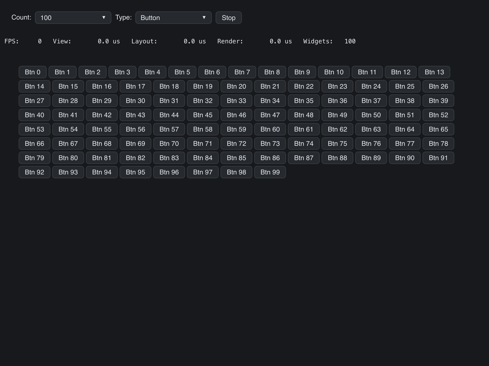

# Benchmark

> **Framework:** performance, layout **Description:** Renders large batches of
> widgets to measure frame cost. Reports timing for 500-item batches across
> mixed types.



<!-- explorer: tags=performance,layout category=performance run=go -->

---

## Run

```sh
go run ./examples/benchmark/
```

## What it demonstrates

Renders large batches of widgets to measure frame cost.

The first metrics line shows FPS, the median (p50), the p99 and the longest
frame time. FPS is frames divided by their total time, not a mean of per-frame
FPS values, which reads too high when frame times vary. A mean also hides
stutter, so read p99 and max too. The second line shows go-gui's mean view,
layout and render CPU time per frame, each with its p99. The numbers show after
500 frames and cover the last 4096 frames.

See `main.go` for the implementation.
