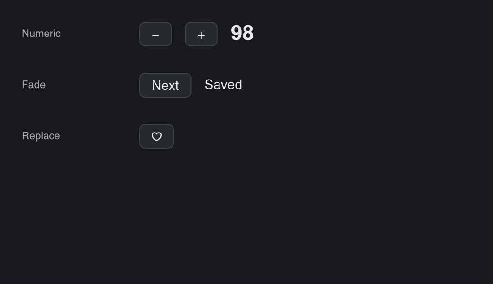

# Content Transition

> **Framework:** text **Description:** One row for each kind of
> `TextCfg.Transition`: a counter whose digits roll, a status word that fades to
> the next, and an icon that shrinks away while the next one grows in.



<!-- explorer: tags=animation,text category=text run=go -->

---

## Run

```sh
go run ./examples/content_transition/
```

## What it demonstrates

Each row is labeled with the name of its `ContentTransitionKind`.

- **Numeric.** Click + or −. Only the digits that change roll. A larger number
  comes up from below, a smaller one comes down from above. From 99 to 100, all
  three columns roll.
- **Fade.** Click Next. The status word fades to the next word.
- **Replace.** Click the heart. The outline heart shrinks away while the filled
  heart grows in.
- **Render-only frames.** The text moves with no view function and no layout for
  each frame.
- **Reduced motion.** When the system asks for it, every kind fades.

See `main.go` for the implementation.
