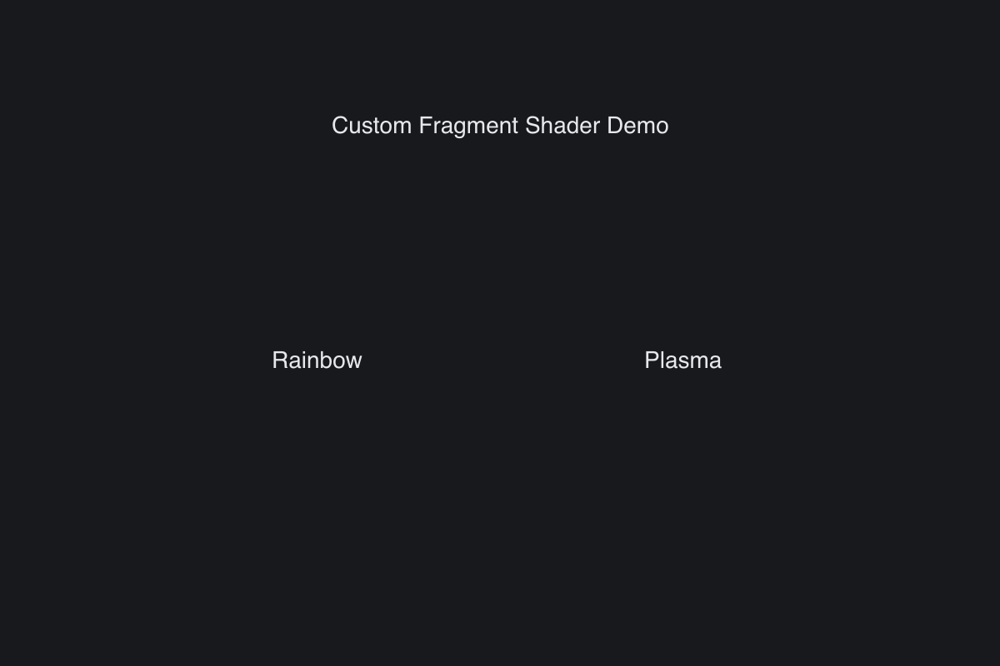

# Custom Shader

> **Framework:** graphics, performance **Description:** Animated fragment
> shaders inside ordinary containers. Requires a GPU and cannot be captured
> headlessly.



<!-- explorer: tags=graphics,performance category=graphics run=go-gpu -->

---

## Run

```sh
go run ./examples/custom_shader/
```

## What it demonstrates

Two containers painted by fragment shaders, a rainbow and a plasma that move
over time. The shaders read Shadertoy's built-in `iTime` and set
`Shader.Animate`. The app keeps no clock and registers no animation, and each
frame rebuilds only the render commands, not the view or the layout.

Requires a GPU. The headless `soft` backend has no shader compiler, so a
screenshot shows the containers without their shader fill.

## How it works

```go
// rainbowTile is an animated shader. iTime counts seconds from the
// first frame that drew a shader. Animate keeps frames coming while
// the tile is on screen, and each frame rebuilds only the render
// commands: no view function runs and nothing is re-arranged.
func rainbowTile() gui.View {
	return gui.Column(gui.ContainerCfg{
		Width:  180,
		Height: 180,
		Sizing: gui.FixedFixed,
		Radius: gui.RadiusPx(16), // ergonomics-audit:spacing — decorative radius, not a control corner
		HAlign: gui.HAlignCenter,
		VAlign: gui.VAlignMiddle,
		Shader: &gui.Shader{
			Metal: `
				float2 st = in.uv * 0.5 + 0.5;
				float3 c = 0.5 + 0.5 * cos(iTime + st.xyx + float3(0,2,4));
				float4 frag_color = float4(c, 1.0);
			`,
			GLSL: `
				vec2 st = uv * 0.5 + 0.5;
				vec3 c = 0.5 + 0.5 * cos(iTime + st.xyx + vec3(0,2,4));
				vec4 frag_color = vec4(c, 1.0);
			`,
			Animate: true,
		},
		Content: []gui.View{gui.Text(gui.TextCfg{Text: "Rainbow"})},
	})
}

```

Each shader is written twice: `Metal` for macOS and iOS, `GLSL` for desktop
OpenGL, WebGL2 and Android. A body declares `frag_color`; the framework clips it
to the container's rounded corners. `uv` spans -1..1 across the container with y
growing down, while `iResolution` is the container size in physical pixels, as
on Shadertoy.

See `docs/specs/custom-shader-backgrounds.md` for the full list of built-in
inputs.
