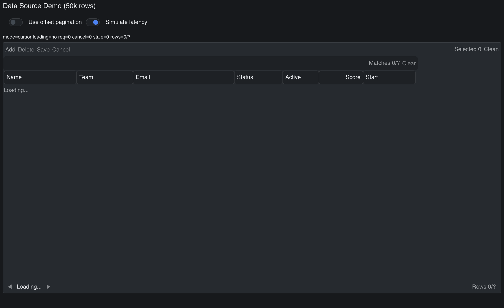

# Data Grid Data Source

> **Framework:** data, performance **Description:** Large data grid backed by a
> paged in-memory source. Shows sorting, filtering, and virtualized row
> rendering.



<!-- explorer: tags=data,performance category=data run=go -->

---

## Run

```sh
go run ./examples/data_grid_data_source/
```

To measure rendering while the grid scrolls, pass `-autoscroll` with a step in
pixels per frame. It also turns the simulated latency off, so each page arrives
in the frame that asks for it. With `GOGUI_RENDER_STATS=1` the backend prints
draw calls, batch causes and GPU time once per second (#1303):

```sh
GOGUI_RENDER_STATS=1 go run ./examples/data_grid_data_source/ -autoscroll 40
```

## What it demonstrates

Large data grid backed by a paged in-memory source. Shows sorting, filtering,
and virtualized row rendering.

See `main.go` for the implementation.
