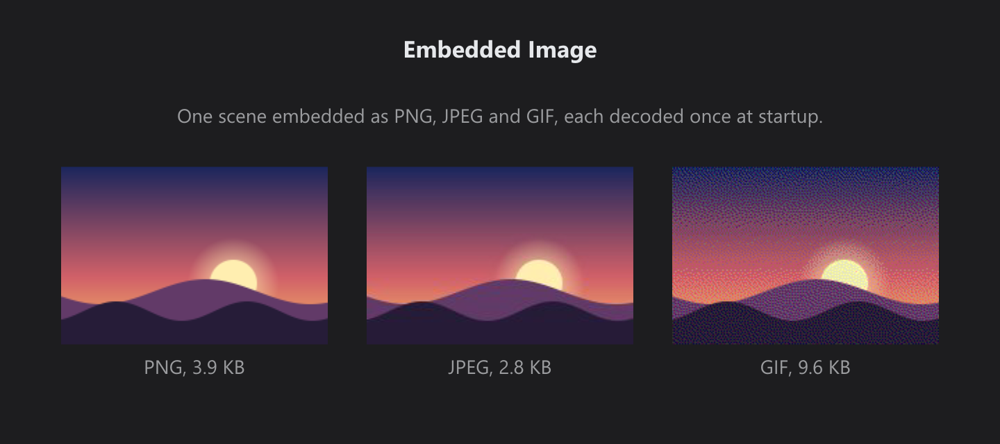

# Embedded Image

> **Framework:** graphics **Description:** One scene embedded with `go:embed` as
> PNG, JPEG and GIF, each decoded once by `RegisterEncodedImage` and drawn with
> the Image widget.



<!-- explorer: tags=graphics category=graphics run=go -->

---

## Run

```sh
go run ./examples/embedded_image/
```

## What it demonstrates

`gui.RegisterEncodedImage` decodes PNG, JPEG or GIF bytes and returns a source
for `ImageCfg.Src` or `DrawContext.Image`. The bytes here come from `go:embed`;
a network response or a database works the same way. No temporary file is
written.

- Each image is decoded once, at startup. The app keeps the returned sources in
  its window state for the whole run.
- A kept source stays valid: the in-memory image budget never evicts a
  `RegisterEncodedImage` image. `gui.DropImage(key)` releases one.
- The key names the content. Register changed bytes under a new key.
- The GIF looks grainy. GIF stores at most 256 colours, so its encoder dithered
  the sky's gradient.
- For pixels your code generates while it builds each frame, use `gui.UseImage`
  instead. The showcase Image guide compares every image source.

## How it works

```go
//go:embed sunset.png
var sunsetPNG []byte

//go:embed sunset.jpg
var sunsetJPEG []byte

//go:embed sunset.gif
var sunsetGIF []byte

// picture is one decoded image and the caption under it.
type picture struct {
	caption string
	src     string
}

func loadPictures() ([]picture, error) {
	encoded := []struct {
		format, key string
		data        []byte
	}{
		{"PNG", "embedded_image/sunset.png", sunsetPNG},
		{"JPEG", "embedded_image/sunset.jpg", sunsetJPEG},
		{"GIF", "embedded_image/sunset.gif", sunsetGIF},
	}
	pictures := make([]picture, 0, len(encoded))
	for _, e := range encoded {
		src, err := gui.RegisterEncodedImage(e.key, e.data)
		if err != nil {
			return nil, fmt.Errorf("%s: %w", e.key, err)
		}
		caption := fmt.Sprintf("%s, %.1f KB", e.format, float64(len(e.data))/1024)
		pictures = append(pictures, picture{caption: caption, src: src})
	}
	return pictures, nil
}
```
