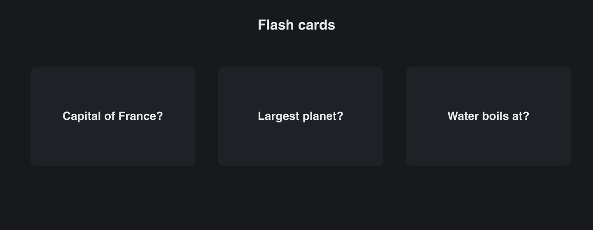

# Flip Panel

> **Framework:** layout **Description:** Flash cards built with `gui.FlipPanel`:
> each card turns over in 3D to show its answer.



<!-- explorer: tags=animation,layout category=layout run=go -->

---

## Run

```sh
go run ./examples/flip_panel/
```

## What it demonstrates

- **App-owned face.** The app keeps one `flipped` bool per card and inverts it
  in `OnFlip`. The panel turns whenever `Flipped` changes.
- **Spring turn.** A spring runs the turn in render-only frames. A second click
  during a turn sends the card back with no jump.
- **Axis.** The first two cards turn side to side (`FlipAxisY`, the default).
  The last turns top to bottom (`FlipAxisX`).
- **Keyboard and screen readers.** Each card is a tab stop and turns on Enter or
  Space. The face that is turned away takes no clicks and is not in the
  accessibility tree.
- **Reduced motion.** When the system asks for it, the faces cross-fade and do
  not turn.

See `main.go` for the implementation and `docs/specs/flip-panel.md` for the
design.
