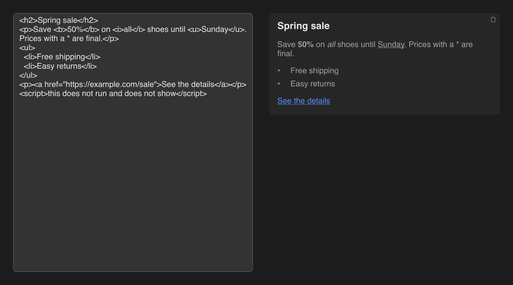

# HTML Preview

> **Framework:** text **Description:** Live preview of an HTML snippet with the
> HTML view. Edit the HTML on the left; the right side renders it.



<!-- explorer: tags=text category=text run=go -->

---

## Run

```sh
go run ./examples/html_preview/
```

## What it demonstrates

`Window.HTML` renders a small, safe subset of HTML. This example is the use case
from issue #1158: an admin panel that previews a promo banner a mobile app
shows.

The view is not a browser. It has no CSS, no script and no layout engine. Each
tag maps to a block or a text style that the Markdown view already draws:

| HTML                                | Renders as                       |
| ----------------------------------- | -------------------------------- |
| `p`, `div`, `br`, `hr`              | paragraph, line break, rule      |
| `h1`–`h6`                           | headings                         |
| `b`/`strong`, `i`/`em`, `u`, `s`    | bold, italic, underline, strike  |
| `mark`, `sup`, `sub`, `code`, `pre` | highlight, super/subscript, code |
| `blockquote`                        | quote                            |
| `ul`, `ol` (`start`), `li`          | lists                            |
| `a href`                            | link                             |
| `img src alt width height`          | image                            |

Other tags are dropped and their text is kept. `script`, `style` and similar
elements are dropped with their content. Text such as `*` or `#` stays literal.

## How it works

```go
// preview renders the snippet with the HTML view. It takes the same
// MarkdownCfg as w.Markdown. Remote images stay blocked unless
// AllowRemoteImages is set, so a preview does not fetch from hosts
// the snippet names.
func preview(w *gui.Window, source string) gui.View {
	theme := gui.CurrentTheme()
	return w.HTML(gui.MarkdownCfg{
		ID:         "preview",
		Source:     source,
		Color:      theme.ColorPanel,
		SizeBorder: gui.BorderThin,
		Radius:     gui.RadiusMedium,
		Padding:    theme.PaddingMedium,
	})
}
```

`w.HTML` takes the same `MarkdownCfg` as `w.Markdown`. Remote images stay
blocked unless `AllowRemoteImages` is set, so the preview does not fetch from
hosts that the snippet names.

See `main.go` for the full program.
