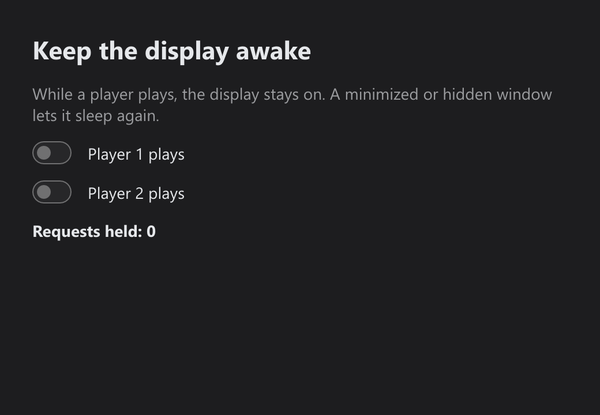

# Keep Awake

> **Framework:** system, platform **Description:** `Window.KeepAwake` keeps the
> display on while a window is on screen, for example while a video plays.



<!-- explorer: tags=system,platform,window category=system run=go -->

---

## Run

```sh
go run ./examples/keep_awake/
```

## What it demonstrates

Turn a player on and leave the computer alone: the display stays on past its
sleep timeout. Turn both players on, then one off: the display still stays on,
because the other player holds its own request. Minimize the window and the
display may sleep again. Restore it and the request is back.

On Windows, `powercfg /requests` in an administrator shell lists the request
under DISPLAY and SYSTEM, with the reason "Player 1 is playing".

## How it works

```go
// setPlaying starts or stops player i. A playing player holds its own
// request to keep the display on; stopping it ends only that request.
func setPlaying(w *gui.Window, i int, playing bool) {
	app := gui.State[App](w)
	switch {
	case playing && app.release[i] == nil:
		app.release[i] = w.KeepAwake(fmt.Sprintf("Player %d is playing", i+1))
	case !playing && app.release[i] != nil:
		app.release[i]()
		app.release[i] = nil
	}
}
```

- `KeepAwake` returns the function that ends the request. Calling it a second
  time does nothing.
- Each call is its own request. The display may sleep only once every request is
  released.
- The OS gets one request for the whole app. It is held while some window with a
  request is visible and not occluded, so a minimized or hidden player does not
  keep the display on.
- Closing a window ends its requests.
- `KeepAwake` and the release are safe from any goroutine, such as a playback
  loop.

## Platforms

| Platform | How                                                       | Where to see it                 |
| -------- | --------------------------------------------------------- | ------------------------------- |
| Windows  | a power request for the display and the system            | `powercfg /requests` (as admin) |
| macOS    | an `NSProcessInfo` activity that stops idle display sleep | `pmset -g assertions`           |
| Linux    | Wayland: an idle inhibitor; X11: ScreenSaver over D-Bus   | `gnome-session-inhibit --list`  |
| Web      | a Screen Wake Lock                                        | the browser's dev tools         |
| iOS      | `UIApplication.idleTimerDisabled`                         |                                 |
| Android  | `FLAG_KEEP_SCREEN_ON`, set by the app's host              |                                 |

On a Modern Standby PC running on battery, Windows ends the system part five
minutes after the sleep timeout. On Wayland every window carries an idle
inhibitor (the idle-inhibit protocol); sway shows it as `inhibit_idle` in
`swaymsg -t get_tree`, and GNOME lists it under "mutter". A compositor without
the protocol (weston, GNOME before 45) gets the D-Bus request instead, and an
X11 desktop without the ScreenSaver service ignores it. The web needs HTTPS or
localhost, and the browser may refuse, for example in power saver mode; the
reason goes to the browser console. On Android the request needs the host's
help: see `examples/android_demo`. Where the request is refused, `GOGUI_DEBUG=1`
says so once.

See `main.go` for the implementation.
