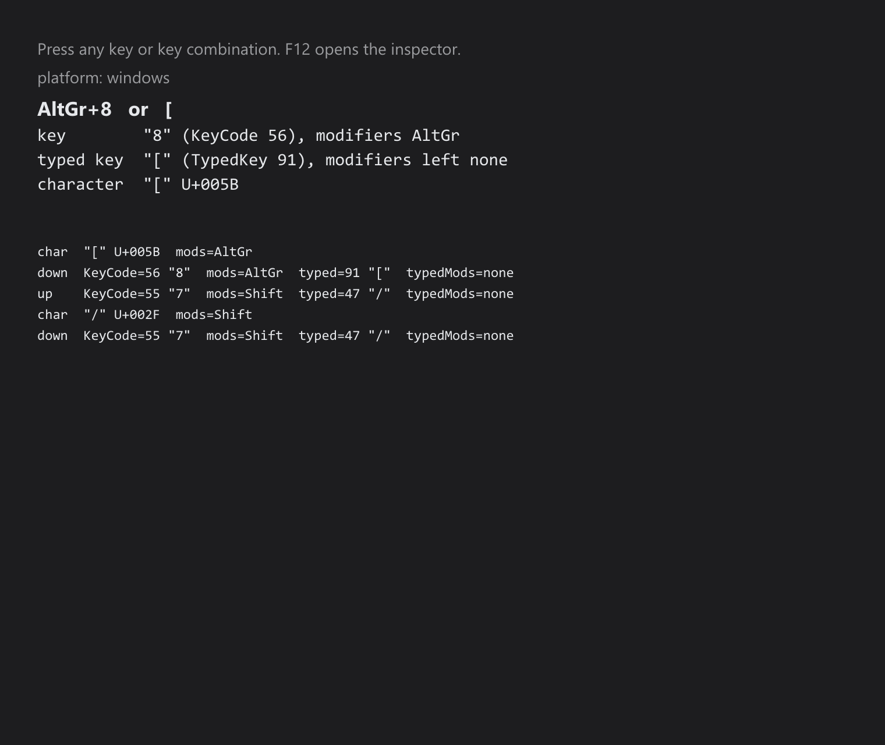

# Key Inspector

> **Framework:** input, system **Description:** Shows every key event the window
> receives: the key, the key it typed, the modifiers, the character and the
> shortcut to bind it with. Use it to check a keyboard layout.



<!-- explorer: tags=input,system category=input run=go -->

---

## Run

```sh
go run ./examples/key_inspector/
```

Press keys and key combinations. The top shows the last key down; the list below
shows every key down, key up and typed character, newest first. Each line is
also printed to the terminal, each key down with the title line's binding, so
you can copy it into a bug report.

F12 opens the built-in inspector and does not reach the list.

## What it shows

For each key down:

- **key**: the `KeyCode` the key reports and the `Modifiers` held. On a German
  layout Shift+7 is `7` with Shift.
- **typed key**: the key the press produced with Shift, AltGr and NumLock
  applied (`TypedKey`), and the modifiers that translation left over
  (`TypedModifiers`). Shift+7 on German types `/` with no modifiers left.
- **character**: the text the press typed, if any.
- **the title line**: how to bind the press as a `Shortcut`, by its key and,
  when it typed another key, by that too: `Shift+7   or   /`. A command bound
  either way runs; an exact `KeyCode` match wins over a typed one.

On Linux the second line says whether the window runs on Wayland or X11.
`GOGUI_WAYLAND=0` runs it on X11 (XWayland) in a Wayland session.

See `docs/specs/keyboard-layouts.md` for the rules behind each value.
