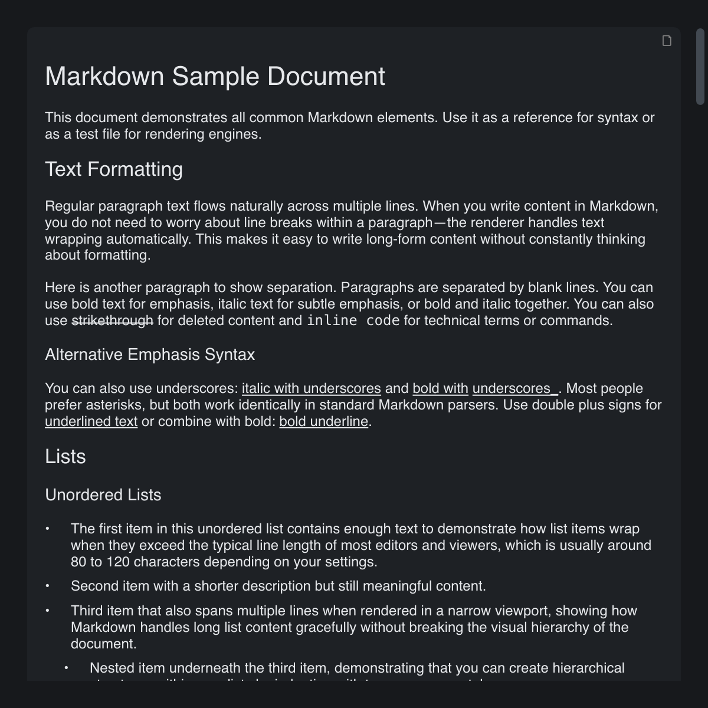

# Markdown

> **Framework:** text **Description:** Embedded markdown document rendered with
> the Markdown view. Shows headings, lists, code, and tables.



<!-- explorer: tags=text category=text run=go -->

---

## Run

```sh
go run ./examples/markdown/
```

## What it demonstrates

Embedded markdown document rendered with the Markdown view. Shows headings,
lists, code, and tables.

See `main.go` for the implementation.

## Mermaid diagrams

Mermaid blocks render as PNG images from a Kroki server. This demo turns
external rendering off with `DisableExternalAPIs: true`, so its diagrams show as
code.

To render diagrams:

1. Call `gui.SetMarkdownExternalAPIsEnabled(true)` once at startup.
2. Remove `DisableExternalAPIs: true` from the `MarkdownCfg`.

The default server is the public `https://kroki.io`. It receives the diagram
source and is sometimes slow or down. To use your own server instead:

1. Start Kroki: `docker run -d -p 8000:8000 yuzutech/kroki` (also run the
   `yuzutech/kroki-mermaid` companion container; see the Kroki docs).
2. Set `MermaidFetcher: gui.KrokiMermaidFetcher("http://localhost:8000")` on the
   `MarkdownCfg`.
