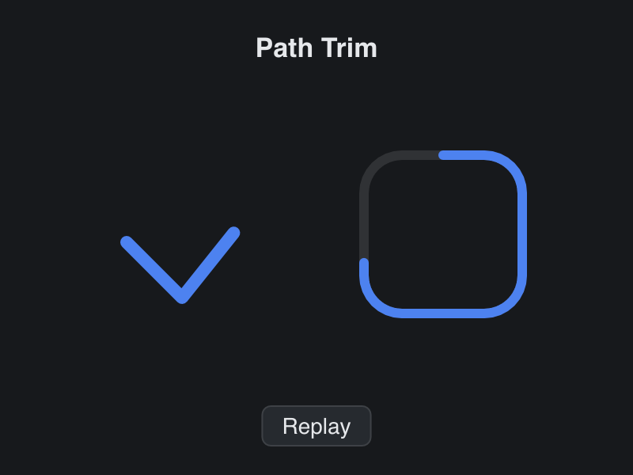

# Path Trim

> **Framework:** graphics **Description:** A check mark and a progress ring that
> draw themselves in, with CanvasPath.TrimTo.



<!-- explorer: tags=graphics,animation category=graphics run=go -->

---

## Run

```sh
go run ./examples/path_trim/
```

## What it demonstrates

`CanvasPath.TrimTo` copies the part of a path between two fractions of its
length. Animate the end fraction from 0 to 1 and the stroke draws itself in.
Click **Replay** to see it again.

- The check mark is two lines. The ring is a custom path of lines and arcs.
- Length is measured over the flattened path, at the stroke tolerance. Curves
  and arcs stay curves and arcs in the trimmed copy.
- The two paths are built once. One `trimmed` path takes each trimmed copy in
  turn, so the redraw does not allocate.
- The tween asks for render-only frames, and the canvas reads its version
  through `VersionFn`. Each tick repaints the canvas with no view function and
  no layout.

## How it works

```go
// drawPaths strokes the part of each path that progress gives, over a
// faint track that shows the whole ring.
func drawPaths(dc *gui.DrawContext, s *app, theme gui.Theme) {
	if s.mark.IsEmpty() {
		buildPaths(s)
	}
	round := gui.StrokeStyle{Cap: gui.StrokeRoundCap, Join: gui.StrokeRoundJoin}

	s.mark.TrimTo(&s.trimmed, 0, s.progress)
	dc.StrokePath(&s.trimmed, theme.ColorSelect, 8, round)

	dc.StrokePath(&s.ring, theme.ColorBorder, 6, round)
	s.ring.TrimTo(&s.trimmed, 0, s.progress)
	dc.StrokePath(&s.trimmed, theme.ColorAccent, 6, round)
}
```

See `main.go` for the implementation.
