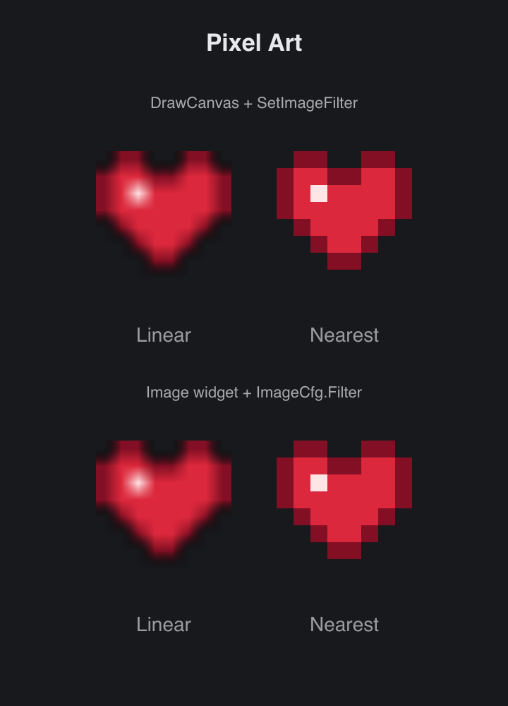

# Pixel Art

> **Framework:** graphics **Description:** One small sprite drawn at 12x, smooth
> with the linear image filter and sharp with the nearest filter, on a canvas
> and with the Image widget.



<!-- explorer: tags=graphics category=graphics run=go -->

---

## Run

```sh
go run ./examples/pixel_art/
```

## What it demonstrates

`DrawContext.SetImageFilter` sets how the image calls that follow sample their
texels. The default, `ImageFilterLinear`, blends texels, so a small image drawn
large looks blurred. `ImageFilterNearest` takes one texel per pixel, so each
texel stays a sharp square. Use it for pixel art, retro UIs and small sprites.

- The sprite is an 8x8 in-memory image registered with `gui.UseImage`.
- The filter is saved and restored by `Save`/`Restore`, with the transform.
- Each `OnDraw` starts with the linear filter.
- The `Image` widget takes the same filter in `ImageCfg.Filter`. The zero value
  is linear.

## How it works

```go
// drawSprites draws the sprite twice at the same size. The left copy
// uses the default linear filter and looks blurred. The right copy
// sets the nearest filter inside Save/Restore, so each texel stays a
// sharp square and the filter goes back to linear after it.
func drawSprites(dc *gui.DrawContext, src string) {
	dc.Image(0, 0, drawn, drawn, src, gui.Opt[float32]{}, gui.Color{})

	dc.Save()
	dc.SetImageFilter(gui.ImageFilterNearest)
	dc.Image(drawn+gap, 0, drawn, drawn, src, gui.Opt[float32]{}, gui.Color{})
	dc.Restore()
}
```

See `main.go` for the implementation.

## The Image widget

The second row draws the sprite with two `Image` widgets. `ImageCfg.Filter`
takes the same `ImageFilter` values as `SetImageFilter`:

```go
// imageRow draws the same sprite with two Image widgets. The left one
// keeps the zero Filter, which is linear. The right one sets
// ImageFilterNearest, so each texel stays a sharp square.
func imageRow(src string) gui.View {
	return gui.Row(gui.ContainerCfg{
		Spacing:    gui.SpacingPx(gap),
		Padding:    gui.PaddingNone,
		SizeBorder: gui.NoBorder,
		Content: []gui.View{
			gui.Image(gui.ImageCfg{Src: src, Width: drawn, Height: drawn}),
			gui.Image(gui.ImageCfg{
				Src:    src,
				Width:  drawn,
				Height: drawn,
				Filter: gui.ImageFilterNearest,
			}),
		},
	})
}
```
