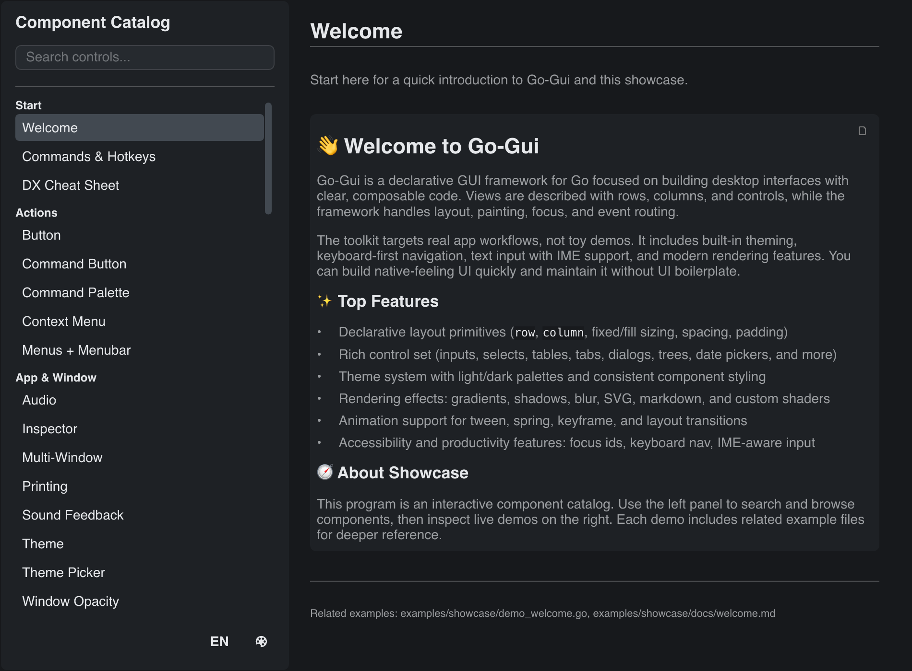

# Showcase

> **Framework:** system, layout, theme **Description:** Full widget gallery with
> a dev-mode inspector. Catalog of every control and visual style.



<!-- explorer: tags=system,layout,theme category=system run=go -->

---

## Run

```sh
go run ./examples/showcase/
```

## What it demonstrates

Full widget gallery with a dev-mode inspector. Catalog of every control and
visual style.

See `main.go` for the implementation.

## Narrow windows and phones

Below 780 px wide the catalog leaves the side of the page. The page takes the
full width under a top bar, and the ☰ button opens the catalog as a drawer over
it. Picking an entry, tapping the dimmed page, ☰ or Esc closes the drawer. On a
wider window the ☰ in the catalog header slides the catalog shut. `nav.go`
holds the layout switch.

To try the web build at phone width:

```sh
cd examples/showcase
make serve   # then open http://localhost:8080 in a phone-sized viewport
```
