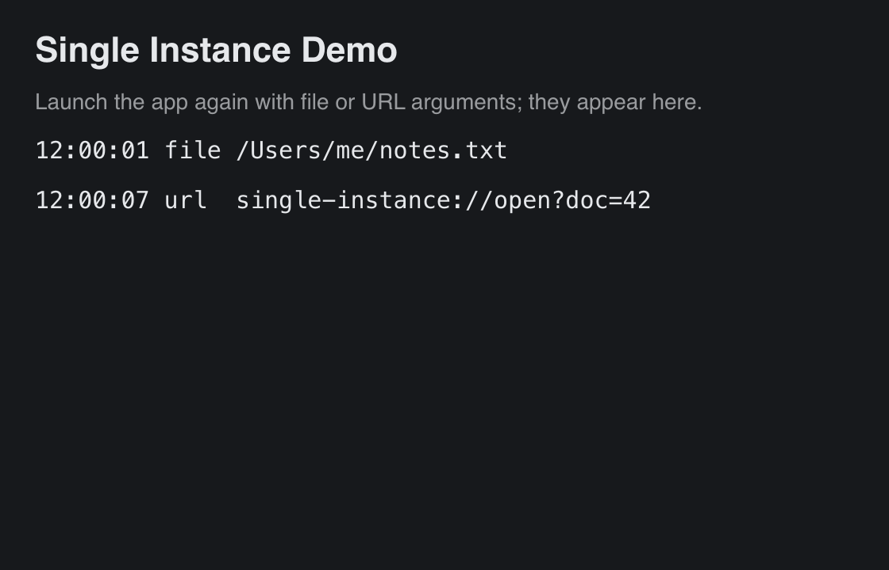

# Single Instance

> **Framework:** system, platform **Description:** One running copy per user. A
> second launch hands its files and URLs to the first, which lists them.



<!-- explorer: tags=system,platform category=system run=go -->

---

## Run

```sh
go build -o /tmp/single_instance ./examples/single_instance/
/tmp/single_instance &
/tmp/single_instance notes.txt single-instance://open?doc=42
```

The second command exits at once. Its file and URL appear in the first window.

## The code

```go
// run elects this process or forwards its arguments, then runs the app.
func run() {
	lock, primary, err := instance.Acquire(info.ID)
	if err != nil {
		log.Printf("single instance: %v", err)
	}
	if !primary {
		return // the running copy has this launch's arguments
	}
	defer func() { _ = lock.Close() }()

	app := gui.NewApp()
	app.OnOpen = onOpen
	lock.Attach(app)
	backend.RunApp(app, newWindow())
}
```

- `instance.Acquire` returns `primary=true` for the first process with this app
  ID. A later process sends its arguments to the first and gets `false`.
- When the election itself fails (for example, no writable lock directory),
  `Acquire` returns `primary=true` and an error. The app runs as usual, without
  single-instance mode.
- `lock.Attach` sends this launch's arguments, and each forwarded launch, to
  `App.OnOpen` as a `gui.OpenEvent`. `gui.ParseOpenArgs` skips flags and sorts
  the rest into files (made absolute) and URLs.
- `App.OnOpen` runs on the main thread. The window rebuilds after it, so a
  change to window state shows at once.

## macOS: open from Finder and URL schemes

Files opened from Finder or the Dock, and links in a scheme the bundle
registers, come as Apple Events, not as arguments. The Metal backend delivers
them to `App.OnOpen` at launch and while the app runs. Only `backend.RunApp`
delivers them; `backend.Run` has no `App`.

Package the app with `buildapp`, then add the types it opens to
`Contents/Info.plist` (`buildapp` does not write them yet):

```sh
go run ./cmd/buildapp -manifest examples/single_instance/appinfo.toml \
  -o /tmp /tmp/single_instance
plutil -insert CFBundleURLTypes -json \
  '[{"CFBundleURLName":"org.go-gui.single-instance","CFBundleURLSchemes":["single-instance"]}]' \
  "/tmp/Single Instance Demo.app/Contents/Info.plist"
plutil -insert CFBundleDocumentTypes -json \
  '[{"CFBundleTypeRole":"Viewer","LSItemContentTypes":["public.plain-text"]}]' \
  "/tmp/Single Instance Demo.app/Contents/Info.plist"
codesign --force -s - "/tmp/Single Instance Demo.app"
open -a "/tmp/Single Instance Demo.app" notes.txt
```

## Platforms

| Platform     | Election               | Forwarding                    |
| ------------ | ---------------------- | ----------------------------- |
| macOS, Linux | `flock` on a lock file | Unix socket, 0600             |
| Windows      | named mutex (`Local\`) | named pipe, current user only |
| Web, mobile  | none                   | none (every process primary)  |

The lock file and socket live in `$XDG_RUNTIME_DIR`, or else in a 0700
`gogui-<uid>` directory in the system temp directory.
