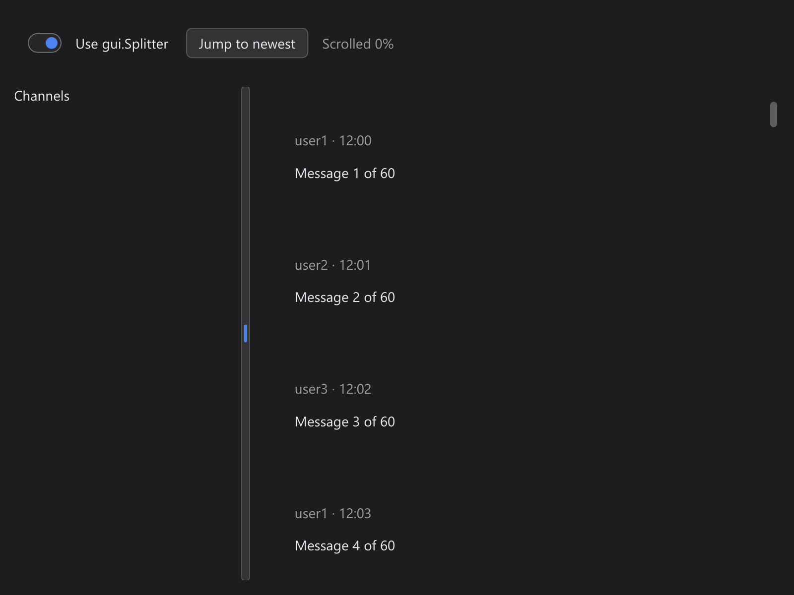

# Splitter Scroll

> **Framework:** layout, scroll **Description:** A chat-style scrollable list
> inside a Splitter pane, with a switch to compare it against the same list in a
> plain Row.



<!-- explorer: tags=layout,scroll category=layout run=go -->

---

## Run

```sh
go run ./examples/splitter_scroll/
```

## What it demonstrates

The second pane of a `gui.Splitter` holds a scrollable `Column` of messages.
Each message is a `Row` (`FillFit`) holding a `Column` (`FitFit`) with a header
line and the text: rows that are containers, not plain `Text`.

- **Use gui.Splitter** switches between the Splitter and a plain `Row` with a
  fixed-width first pane. The plain `Row` is the control: its scroll range has
  always been right.
- **Jump to newest** scrolls the list to its end with `ScrollVerticalToPct`.
- The status line shows how far the list is scrolled.

Scroll down with the wheel in both layouts. Each one must reach the newest
message and show 100%. Before issue #1214 was fixed, the Splitter pane stopped
at about 14% and the newest messages could not be reached.

See `main.go` for the implementation.
