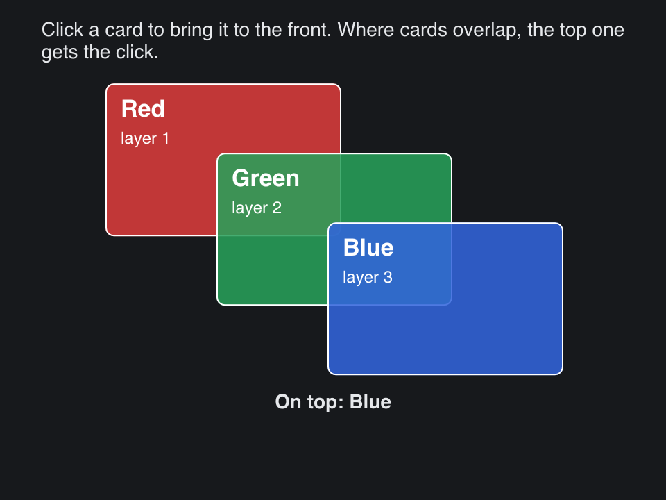

# Stack

> **Framework:** layout **Description:** A Stack lays its children in layers.
> Three cards overlap; click one to bring it to the front.



<!-- explorer: tags=layout category=layout run=go -->

---

## Run

```sh
go run ./examples/stack/
```

## What it demonstrates

`gui.Stack` puts its children one over the other. The first child is the bottom
layer and the last child is the top layer. Click a card to bring it to the
front.

- Each layer starts at the Stack's content origin. `Spacing` has no effect.
- Each card sits in a `FillFill` wrapper. The wrapper's padding moves the card
  down and right, so the cards overlap.
- The cards are translucent, so where two overlap the lower one shows through.
- The top layer is drawn last and gets the pointer first. Click where Green
  covers Red, and Green comes to the front, not Red.
- A wrapper has no click handler, so a press outside its card goes on to the
  layers under it.
- Layers stay in the tree, so they scroll and clip with the Stack. Use `Float`
  for content that must escape its container, such as a dropdown.

## How it works

```go
// stage lays the cards in a Stack, bottom first. Each card's wrapper
// pads it down and right by a fixed step per card, so a card keeps its
// place when it changes layer: only which card covers which changes.
func stage(s *app, theme gui.Theme) gui.View {
	// The card colors are the same in every theme, so the text on them
	// is too.
	name := theme.TextStyleTitle
	name.Color = gui.White
	note := theme.TextStyleBodySmall
	note.Color = gui.White
	layers := make([]gui.View, 0, len(s.order))
	for layer, c := range s.order {
		step := float32(c)
		layers = append(layers, gui.Column(gui.ContainerCfg{
			// The wrapper covers the whole Stack. It has no click
			// handler, so a press outside its card goes to the layers
			// under it.
			Sizing:     gui.FillFill,
			Padding:    gui.NewPadding(step*50, 0, 0, step*80),
			SizeBorder: gui.NoBorder,
			Content: []gui.View{
				gui.Column(gui.ContainerCfg{
					ID:          cards[c].id,
					Width:       170,
					Height:      110,
					Sizing:      gui.FixedFixed,
					Color:       cards[c].color,
					ColorBorder: gui.White,
					Radius:      gui.RadiusMedium,
					Padding:     gui.PadAll(10),
					Spacing:     gui.SpacingSmall,
					OnClick: func(ctx gui.EventCtx) {
						raise(gui.State[app](ctx.Window), c)
						ctx.Consume()
					},
					Content: []gui.View{
						gui.Text(gui.TextCfg{Text: cards[c].name, TextStyle: name}),
						gui.Text(gui.TextCfg{Text: fmt.Sprintf("layer %d", layer+1), TextStyle: note}),
					},
				}),
			},
		}))
	}
	return gui.Stack(gui.ContainerCfg{
		ID:      "stage",
		Width:   330,
		Height:  210,
		Sizing:  gui.FixedFixed,
		Padding: gui.NoPadding,
		Content: layers,
	})
}
```

See `main.go` for the implementation.
