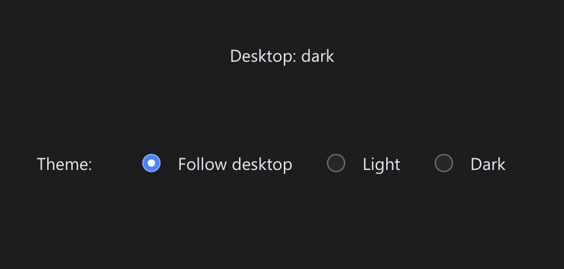

# System Appearance

> **Framework:** theme, system **Description:** `Window.FollowSystemAppearance`
> swaps between a light and a dark theme when the desktop setting changes, and
> `Window.TitlebarDark` keeps the window frame in step.



<!-- explorer: tags=theme,system,appearance category=system run=go -->

---

## Run

```sh
go run ./examples/system_appearance/
```

Switch the desktop between light and dark while the app runs (on GNOME: Settings
→ Appearance; on Windows: Settings → Personalization → Colors). With "Follow
desktop" selected, the theme switches with it. Pick Light or Dark to pin a
theme, and "Follow desktop" to follow again.

## What it demonstrates

- `FollowSystemAppearance(light, dark)` pins the theme that matches the desktop
  and switches it on every change. Each switch also calls `TitlebarDark`, so the
  frame follows where the backend can switch it.
- `OnSystemAppearance` gets every desktop change, whether or not the window
  follows. The app shows the last setting it heard of.
- Light and Dark call `SetTheme`, which ends following. `SetTheme` does not
  touch the frame, so the app also calls `TitlebarDark` with the theme's own
  `TitlebarDark` field.
- With no desktop setting (no backend, or a desktop go-gui cannot read), the
  window keeps its theme, still following, until a setting arrives.

## Where the frame follows

`TitlebarDark` switches the frame on Windows (10 version 1809 or later) and on
Linux under Wayland when libdecor's GTK plugin draws it, as on GNOME.

- On Windows it switches that window's caption. With "Show accent color on title
  bars" turned on, the active caption keeps the accent color; switch to another
  window to see the variant. The app shows a note on this at the bottom of the
  window when it runs on Windows.
- On Windows the window is already showing when `OnInit` runs. This example
  follows from `OnInit`, so on a dark desktop the caption fades from light to
  dark as it opens. Calling `FollowSystemAppearance`, or `TitlebarDark` for a
  pinned theme, before `backend.Run` applies the variant before the window
  shows. Which order fits depends on the app: a slow `OnInit` keeps the window
  blank for longer.
- Under Wayland the variant is one per process, so the last call sets it for
  every window.

Elsewhere `TitlebarDark` does nothing yet, and the frame keeps the variant the
system gives it.

## Test

```sh
go test ./examples/system_appearance/
```
