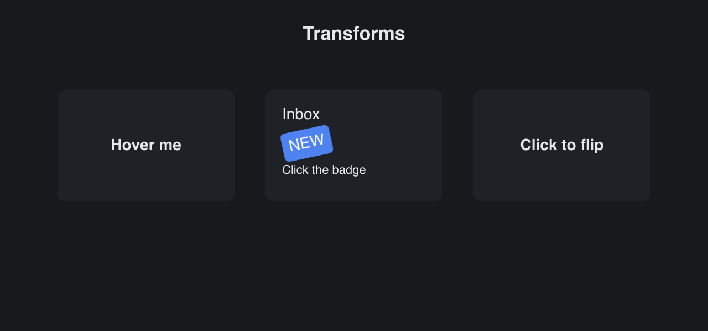

# Transforms

> **Framework:** layout **Description:** View transforms on containers: a card
> that lifts on hover, a tilted badge, and a card that flips in 3D.



<!-- explorer: tags=graphics,animation category=graphics run=go -->

---

## Run

```sh
go run ./examples/transforms/
```

## What it demonstrates

- **Hover lift.** `gui.Translate(0, -6).Scale(1.05)` while the pointer is over
  the card. The hover test is on an outer row that does not move, so the lifted
  card does not slide out from under the pointer.
- **Tilted badge.** `gui.Rotate(-12)`. Layout ignores a transform, so nothing
  around the badge moves. A click on the badge reaches it where it is drawn, and
  `Window.LocalToWindow` maps the click point out to the window.
- **Card flip.** Two faces on one spot, each with
  `gui.Perspective(600).RotateY(a).BackfaceHidden()`. The back face starts at
  180 degrees. Only the face that looks toward the viewer is drawn and takes the
  pointer. The angle is read through `ContainerCfg.TransformFn`, so the tween
  moves the card in render-only frames, with no rebuild.

See `main.go` for the implementation and `docs/specs/view-transforms.md` for the
design.
