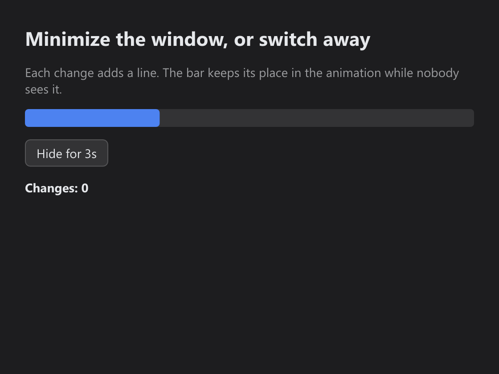

# Visibility

> **Framework:** system, platform **Description:** `EventVisibilityChanged`
> tells an app when nobody sees its window: it is minimized, hidden, or the app
> is in the background. `Window.IsOccluded` and `IsVisible` say which.



<!-- explorer: tags=system,platform,window category=system run=go -->

---

## Run

```sh
go run ./examples/visibility/
```

## What it demonstrates

Minimize the window, switch to another browser tab, or press "Hide for 3s". Each
change adds a line to the log, with how long the window was away. The progress
bar keeps its place in the animation while nobody sees it.

A media player uses the event to stop decoding frames and to pause its audio.

## How it works

```go
// onEvent runs inside the call that changed the state, also while the
// window has no focus. The event carries no state: the two getters do.
func onEvent(e *gui.Event, w *gui.Window) {
	if e.Type != gui.EventVisibilityChanged {
		return
	}
	shown := w.IsVisible() && !w.IsOccluded()
	// A player would call player.SetPaused(!shown) here.
	record(gui.State[App](w), shown, w.IsVisible(), w.IsOccluded(), time.Now())
}
```

Set the handler once: `w.OnEvent = onEvent`.

- `IsVisible` is false after the app's own `Hide`, until `Show`. On the web,
  iOS, Android and native Wayland no window can be hidden: `Hide` does nothing
  there and `IsVisible` stays true.
- `IsOccluded` is true while the OS shows the window nowhere.
- The window is shown when `IsVisible() && !IsOccluded()`. The event fires once
  for each change of that, also where the OS reports a `Hide` as an occlusion.
- The handler runs at once, not with the next frame. On Android, iOS and the web
  no frame is drawn while the app is hidden.

## Platforms

| Platform | `IsOccluded` is true when                                     |
| -------- | ------------------------------------------------------------- |
| Windows  | minimized                                                     |
| macOS    | minimized, fully covered, or on another space                 |
| X11      | minimized                                                     |
| Wayland  | minimized, on another workspace, screen locked, fully covered |
| Web      | the page is hidden: another tab, or a minimized browser       |
| iOS      | the app is in the background                                  |
| Android  | the activity is stopped                                       |

Windows and X11 do not report a window that others cover. Wayland reports a
fully covered window about a second late. Under GNOME, opening the Activities
overview right after minimizing counts as showing the window for a moment: its
thumbnail is painted there. On iOS, Control Center and the notification
pull-down do not count: the app stays on screen behind them. On Android a paused
activity in multi-window mode is still on screen, so it does not count either.

On Android the app's host must report the change; see `examples/android_demo`.
On Android, iOS and the web, animations stop while the app is hidden and go on
at the right phase when it returns. On the desktop they keep running, so their
callbacks keep their timing.

This example runs on desktop and web. In a browser and on native Wayland the
"Hide for 3s" button does nothing, because the window cannot be hidden there.
`examples/ios_demo` and `examples/android_demo` show a line that counts how
often the app left the screen.

See `main.go` for the implementation.
