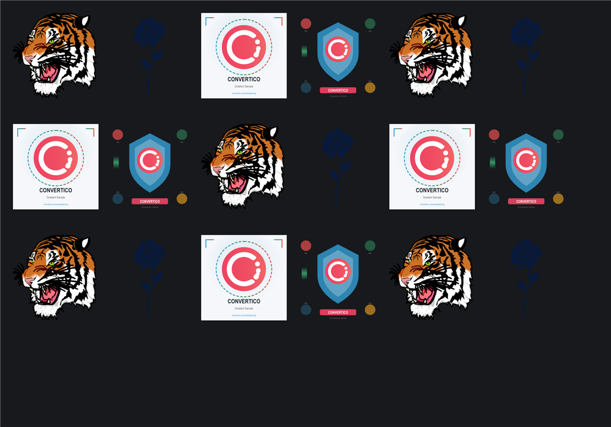

# Web SVG Bench

> **Framework:** platform **Description:** Scrolls a grid of SVGs at a fixed
> rate and records frame times, to compare web renderers on an SVG-heavy page.



<!-- explorer: tags=platform category=platform run=web -->

---

It measures how the web backend copes with SVG while scrolling, and reproduces
the numbers in #1045.

## Run

```sh
go run ./examples/web_svg_bench/serve.go            # builds main.wasm, serves on localhost:8080
go run ./examples/web_svg_bench/serve.go -nobuild   # serve the last build
```

Open `http://localhost:8080/?post=1&label=my-run` in any browser. Keep the tab
in the foreground and don't touch it while it runs. The overlay at the top right
shows the result after the warm-up and measurement time (3 s + 10 s by default).
With `post=1`, the result is also appended to `results.jsonl` in this directory
and printed by the server. It is also in `window.benchResult` in the console.

Natively, the same workload runs on the desktop backends, configured through
`BENCH_<NAME>` environment variables
(`BENCH_ASSET=tiger go run ./examples/web_svg_bench/`).

## URL parameters

| Name       | Default | Meaning                                                                                                                                                                |
| ---------- | ------- | ---------------------------------------------------------------------------------------------------------------------------------------------------------------------- |
| `rows`     | 40      | grid rows                                                                                                                                                              |
| `cols`     | 6       | grid columns                                                                                                                                                           |
| `cell`     | 140     | cell size in px                                                                                                                                                        |
| `asset`    | `mix`   | `tiger`, `flower`, `logo`, `icon` or `mix`                                                                                                                             |
| `period`   | 8       | seconds for one scroll from top to bottom                                                                                                                              |
| `xf`       |         | `rotate`, `tilt`, `persp` or `lift`: each cell in a clipping container with that view transform                                                                        |
| `svg`      |         | `canvas2d` opts out of WebGL2 (the default); the result records the mode in effect                                                                                     |
| `warmup`   | 3       | seconds before measuring                                                                                                                                               |
| `duration` | 10      | seconds measured                                                                                                                                                       |
| `label`    |         | free text stored with the result                                                                                                                                       |
| `post`     |         | `1` = POST the result to the server                                                                                                                                    |
| `shot`     |         | `1` = also save the canvas to `shots/<label>.png` (needs `post=1`)                                                                                                     |
| `lose`     |         | `1` = lose the SVG WebGL context 2 s into the run and restore it 2 s later; reports per-phase frames and composites, saves `<label>-lost.png` / `<label>-restored.png` |

## What it reports

- `fps`, `droppedFrames`: from `requestAnimationFrame` intervals, against the
  refresh interval measured on the idle page first.
- `frameMs`: frame interval percentiles. This is what you see.
- `goLayoutMs` / `goDrawMs`: time in `FrameFn` (layout) and in `renderFrame`
  (draw command replay), from the web backend's `goGuiOnFrame` hook. Canvas2D
  rasterizes after `renderFrame` returns, so `frameMs` minus these is roughly
  what the browser adds.
- `perFrame`: draw commands, SVG commands and SVG triangles per painted frame.
