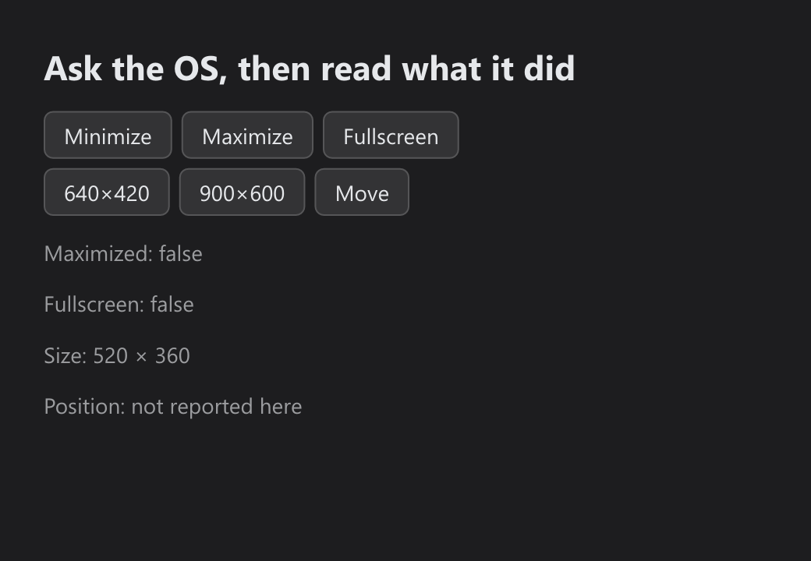

# Window State

> **Framework:** system, platform **Description:** `Window.Minimize`,
> `Maximize`, `Restore`, `SetFullscreen`, `SetWindowSize` and `SetPosition`
> drive the OS window, and the getters report what the OS confirmed.



<!-- explorer: tags=system,platform,window category=system run=go -->

---

## Run

```sh
go run ./examples/window_state/
```

## What it demonstrates

Each button asks the OS for a change and returns. The readout comes from
`IsMaximized`, `IsFullscreen`, `WindowSize` and `Position`, which change once
the OS has confirmed the change, so they also follow the title-bar buttons and
the desktop's keyboard shortcuts.

- A view that reads the getters needs no event: a state change redraws it.
- `Restore` undoes a minimize, then a maximize. It leaves fullscreen alone, and
  `SetFullscreen(false)` ends that.
- A window maximized before fullscreen returns to maximized.
- `Position` is in OS desktop units, not the logical pixels of `WindowSize`.

## Platforms

| Platform     | Minimize, maximize, restore | Fullscreen     | Size | Position |
| ------------ | --------------------------- | -------------- | ---- | -------- |
| Windows      | Yes                         | Yes            | Yes  | Yes      |
| macOS        | Yes                         | Yes            | Yes  | Yes      |
| X11          | Yes                         | Yes            | Yes  | Yes      |
| Wayland      | Yes, see below              | Yes            | Yes  | No       |
| Web          | No                          | Yes, see below | No   | No       |
| iOS, Android | No                          | Not yet        | No   | No       |

Wayland has no request to bring back a minimized window, and a client cannot
read or set its position. A tiling compositor such as sway ignores maximize and
a client's own size.

On the web the whole page goes fullscreen, and only from a click, tap or key
press: a browser refuses it anywhere else. Esc or Back leaves it, and the
readout follows. iPhone Safari has no fullscreen for a page.

See `main.go` for the implementation.
